# LED Studio Master Clock

A fullscreen LED-style master clock in a single HTML file, for TV and radio studios,
ham radio shacks and anywhere else a big, accurate clock is wanted.

## About this clock

I have always been fascinated by studio-style LED clocks, with their sleek and professional appearance often seen in television studios and production environments. Unfortunately, I never had the opportunity to own one myself. After searching extensively for a similar project online and not finding anything that matched my vision, I decided to create one from scratch. This clock is my way of combining my appreciation for studio aesthetics with my passion for programming.

This project is highly versatile and can be used in various ways:

- As a studio-style LED clock with Raspberry Pi and screens.
- By ham radio enthusiasts to display custom call signs alongside the clock.

I am sharing this project to help others who might also be interested in having a similar clock. Feel free to use, customize, or contribute to its development!


## Demo

[aganet.github.io/studio-master-clock](https://aganet.github.io/studio-master-clock/master-clock.html?text=STUDIO%201), served from this repository by GitHub Pages. Add your own parameters to the URL.

## Screenshots

Every picture below is a plain URL. Copy the line under it into the address bar.

Default view, no parameters: local time on the dial, UTC beside it.

```
master-clock.html
```

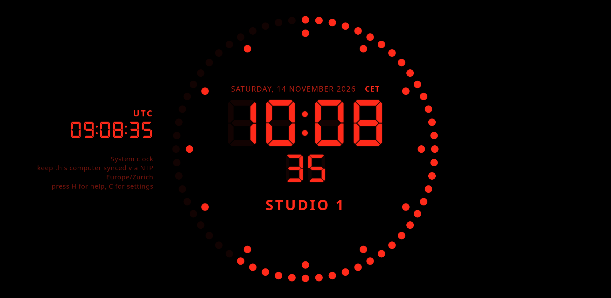

Studio: label, ON AIR sign lit and a countdown running, switched by remote control or the O and T keys.

```
master-clock.html?text=STUDIO%201&onair&countdown=300
```

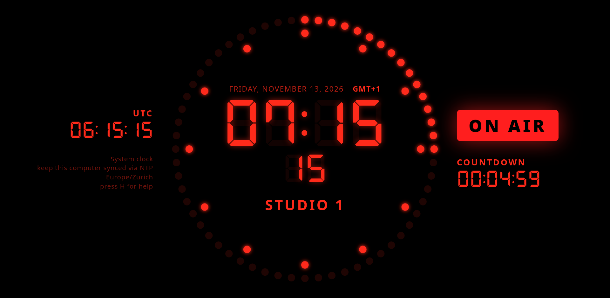

Ham radio: UTC on the dial, local time beside it, call sign and grid as the label.

```
master-clock.html?utc&text=M0JPK%20JN47
```

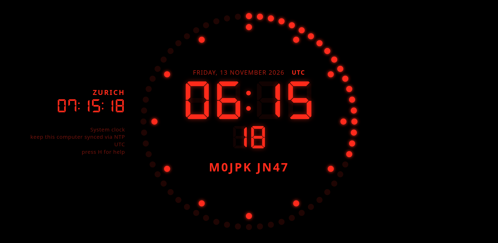

World clock: six zones form a strip along the bottom. Los Angeles is still on the previous day, hence "LA -1".

```
master-clock.html?text=NEWSROOM&zones=UTC,America/Los_Angeles:LA,America/New_York:NYC,Europe/London,Asia/Dubai,Asia/Tokyo
```

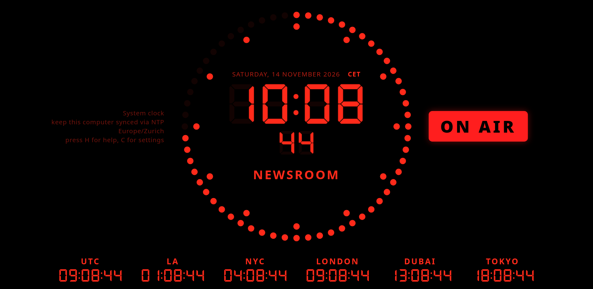

Portrait screen: the extra clocks move to the bottom automatically, two per row.

```
master-clock.html?zones=UTC,America/New_York,Asia/Tokyo,Australia/Sydney
```

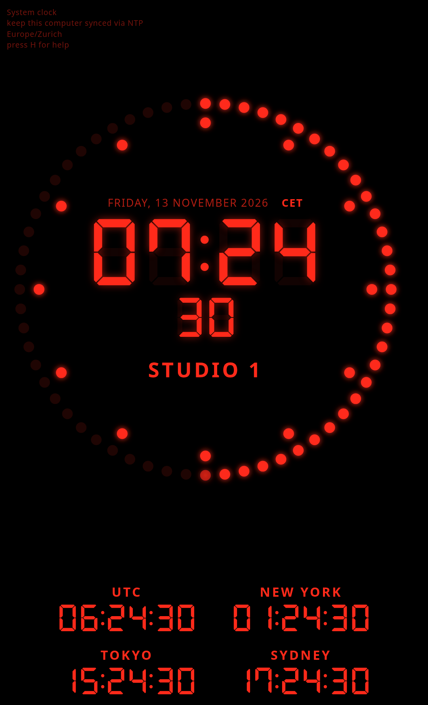

Colours: green, amber, blue and white presets, or any hex value such as `color=ff8800`.

```
master-clock.html?color=green&text=STUDIO%202
master-clock.html?color=amber&text=NEWSROOM
master-clock.html?color=blue&text=CONTROL%20ROOM
master-clock.html?color=white&text=MCR
```

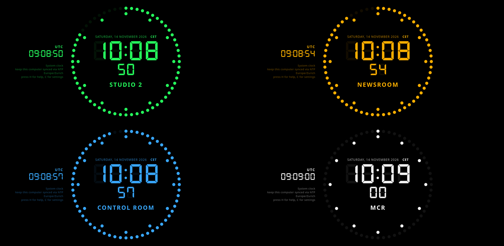

12-hour display with the date in German.

```
master-clock.html?h12&lang=de-CH&color=amber&text=STUDIO%201
```

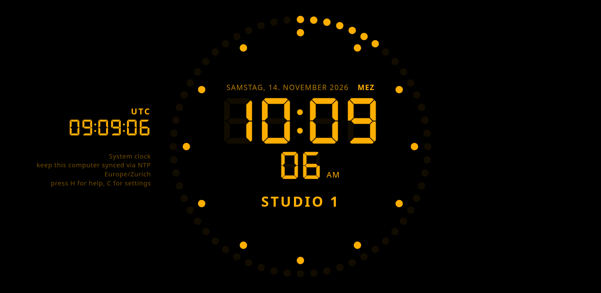

Countdown overrun: the timer turns amber and blinks when the time is up, the ON AIR sign stays lit.

```
master-clock.html?text=STUDIO%201&onair&countdown=60
```

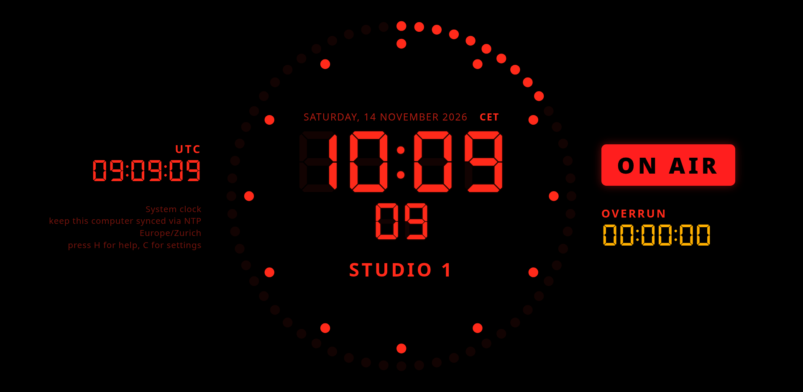

Night dimming for a home display: dimmed between 22:00 and 06:00, full brightness during the day.

```
master-clock.html?text=HOME&night=22-6
```

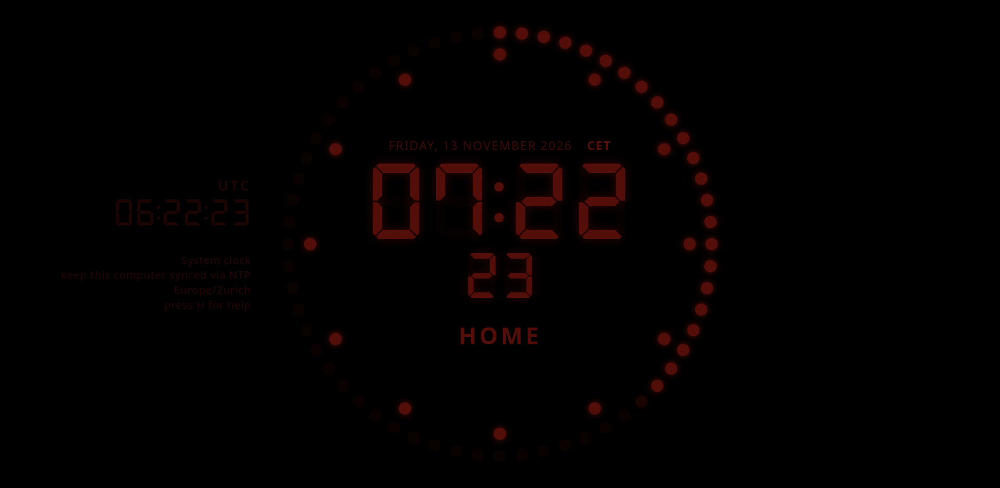

Help overlay, press `H` on any clock. `C` opens the settings panel.

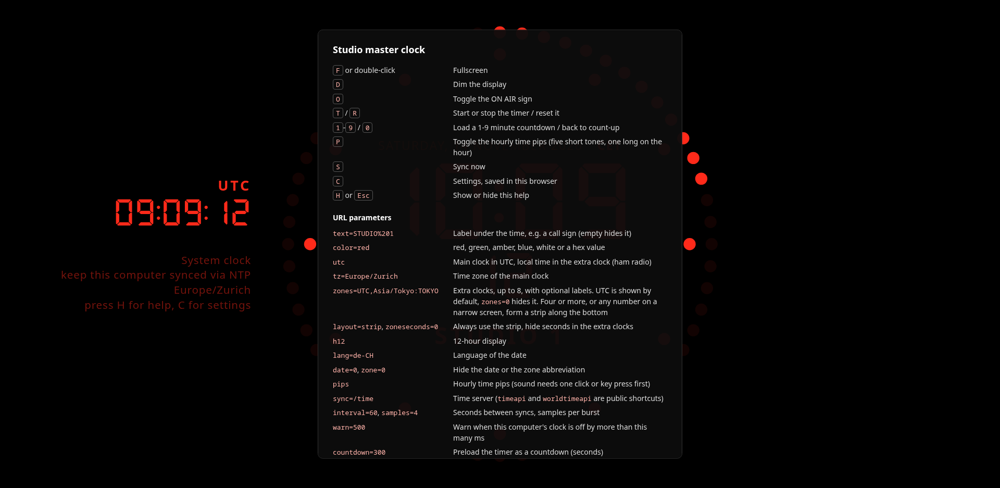

## Features

- Seven-segment LED digits (DSEG7 font, embedded, so the page works offline) with a 60-dot
  second ring and hour markers.
- Date line with the time zone abbreviation (CET, UTC, ...), any IANA time zone, 12 or 24 hour.
- UTC clock beside the dial by default, and up to eight extra clocks in other zones, beside
  the dial or as a strip along the bottom for big screens, each marked +1 or -1 when its
  calendar day differs. `?utc` puts UTC in the main display and local time beside it, the
  usual ham radio setup.
- Custom label under the time: studio name or call sign.
- ON AIR sign, count-up timer and countdown with overrun, hourly time pips.
- Remote control over Server-Sent Events or WebSocket: ON AIR, label, dim, timer.
- Optional time server sync: NTP-style four-timestamp exchange, drift estimation, slewed
  corrections and a holdover state with an error bound when the server goes away.
- Wide screens get the ON AIR sign and timer beside the dial, square and portrait screens
  use the corners. Screen wake lock and hidden cursor.
- Screen care for 24/7 use: black background, pixel shift, scheduled night dimming and
  optional colour cycling to even out OLED wear.
- Settings panel (key `C`) saved in the browser, for people who would rather not edit URLs.
- Installs as an app on phones, tablets and desktops when served over http(s).
- No dependencies, no build step, one file.

## Quick start

Open `master-clock.html` in a browser and press `F` for fullscreen. Everything is configured
through URL parameters, so a kiosk setup is just a bookmark. Press `H` on the clock for the
full list.

### Examples

```
# Studio wall: label, UTC beside the dial, ON AIR sign always visible
master-clock.html?text=STUDIO%201&onair

# Studio with a 5 minute countdown preloaded and the time pips on the hour
master-clock.html?text=STUDIO%201&countdown=300&pips

# Ham radio shack: UTC on the dial, local time beside it, call sign and grid
master-clock.html?utc&text=M0JPK%20JN47

# Home: dimmed at night, colour changes every two hours to spare an OLED
master-clock.html?text=HOME&night=23-7&cycle=120

# Newsroom world clock, six zones with short labels, no seconds in the strip
master-clock.html?text=NEWSROOM&zones=UTC,America/Los_Angeles:LA,America/New_York:NYC,Europe/London,Asia/Dubai,Asia/Tokyo&zoneseconds=0

# Main clock in another zone, 12-hour, date in US English, no extra clock
master-clock.html?tz=America/New_York&h12&lang=en-US&zones=0

# Amber, German date, no date line, only the zone abbreviation
master-clock.html?color=amber&lang=de-CH&date=0

# Disciplined by a time server on the LAN, warn if the PC clock is more than 200 ms off
master-clock.html?sync=http://timeserver.local/time&warn=200

# Remote control from an automation system over Server-Sent Events
master-clock.html?text=STUDIO%202&events=http://automation.local/clock/events

# Kiosk on an OLED: start dimmed, pixel shift on (default), everything else default
master-clock.html?dim
```

### Keys

| Key | Action |
| --- | --- |
| `F` or double-click | Fullscreen |
| `D` | Dim the display |
| `O` | Toggle the ON AIR sign |
| `T` / `R` | Start or stop the timer / reset it |
| `1`-`9` / `0` | Load a 1-9 minute countdown / back to count-up |
| `P` | Toggle the hourly time pips |
| `S` | Sync now |
| `C` | Settings panel |
| `H` or `Esc` | Help |

### URL parameters

| Parameter | Meaning |
| --- | --- |
| `text=STUDIO%201` | Label under the time, empty hides it |
| `color=red` | `red`, `green`, `amber`, `blue`, `white` or a hex value |
| `utc` | Main clock in UTC, local time in the second clock |
| `tz=Europe/Zurich` | Time zone of the main clock |
| `zones=UTC,Asia/Tokyo:TOKYO` | Extra clocks, up to 8, with optional labels after the colon. UTC is shown by default, `zones=0` hides it. Four or more, or any number on a narrow screen, form a strip along the bottom. `tz2=UTC` is the single-clock form |
| `layout=strip`, `zoneseconds=0` | Always use the strip, hide seconds in the extra clocks |
| `h12` | 12-hour display |
| `lang=de-CH` | Language of the date |
| `date=0`, `zone=0` | Hide the date or the zone abbreviation |
| `pips` | Hourly time pips (browsers need one click or key press before playing sound) |
| `sync=timeapi` | Time server, see below. `timeapi` and `worldtimeapi` are public shortcuts, any URL returning an ISO time or epoch works |
| `interval=60`, `samples=4` | Seconds between syncs, samples per burst |
| `warn=500` | Warn when this computer's clock is off by more than this many ms |
| `countdown=300` | Preload the timer as a countdown (seconds) |
| `onair` | Always show the ON AIR sign |
| `events=...`, `ws=...` | Remote control endpoint |
| `dim`, `night=22-6` | Start dimmed, or dim automatically between those hours |
| `cycle=60`, `shift=0` | Change the LED colour every 60 minutes, turn off the pixel shift |

## Settings panel

Press `C` for a form with every option: label, colour, zones, 12-hour, night dimming,
colour cycling, pips and so on. Save stores them in the browser and reloads the clock. They
are used whenever the clock is opened without URL parameters, so a home user never has to
type a URL. URL parameters always win when present, and "Reset to defaults" clears the
saved settings.

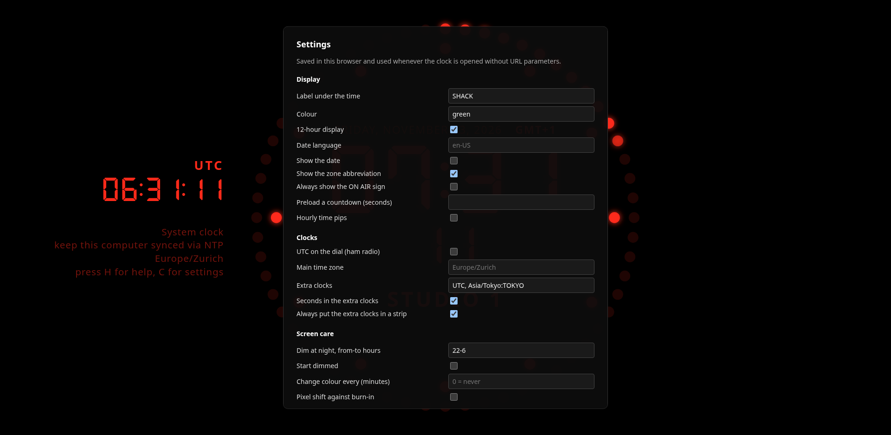

## Install as an app

When the clock is served over http(s), for example from the demo site or your own web
server, browsers offer to install it:

- Chrome and Edge on desktop or Android: the install icon in the address bar, or the browser
  menu, then "Install app". It opens fullscreen without any browser chrome.
- Safari on iPhone and iPad: Share, then "Add to Home Screen".

The installed app keeps the URL it was installed from, parameters included. Settings saved
with `C` work inside the app as well. Opening the file directly from disk works as a normal
page, but browsers do not offer to install from `file://`.

## Time

Without `sync` the clock shows the operating system time, so keep the computer on NTP.
The top-left status says so.

With `sync=<url>` the page disciplines its own clock against a time server: it takes a burst
of samples, keeps the one with the lowest round trip, fits offset and drift over the last 30
minutes, slews small corrections (time never runs backwards) and steps large ones. The status
shows the lock state, the error bound, how far the computer's own clock is off, and the drift
in ppm. If the server disappears the clock goes to holdover and the error bound grows.

## Remote control

The clock listens for commands over Server-Sent Events (`?events=<url>`) or a WebSocket
(`?ws=ws://host:port`). A message is JSON or plain `ON` / `OFF`:

```
ON
{"onair": false, "text": "STUDIO 2"}
{"timer": {"countdown": 300, "start": true}}
{"timer": "stop"}
{"dim": true}
```

Any small server that pushes these to the displays will do.

## Kiosk setup

On a Raspberry Pi or any Linux box, a fullscreen Chromium kiosk is enough:

```
chromium --kiosk --noerrdialogs --disable-infobars "file:///path/to/master-clock.html?text=STUDIO%201"
```

The page requests a screen wake lock and hides the cursor after three seconds.

## Screen care

A clock runs 24/7, so burn-in matters on OLED and plasma screens (LCDs only get temporary
image retention). The background is pure black, so most pixels are off. On top of that:

- The dial shifts a few millimetres every five minutes (`shift=0` turns this off).
- `night=22-6` dims the display between those hours. Brightness is the main factor in OLED
  wear, and `D` or a remote `dim` command still override it until the next boundary.
- `cycle=60` steps through red, green, amber, blue and white every 60 minutes, starting from
  the configured colour, so no single subpixel does all the work. All displays change at the
  same moment because the schedule is derived from the clock time.

## Requirements

- A current browser (Chrome, Edge, Firefox, Safari).

## Credits

- [DSEG](https://github.com/keshikan/DSEG) seven-segment font by keshikan, SIL Open Font License 1.1.

## License

This project is licensed under the MIT License.
